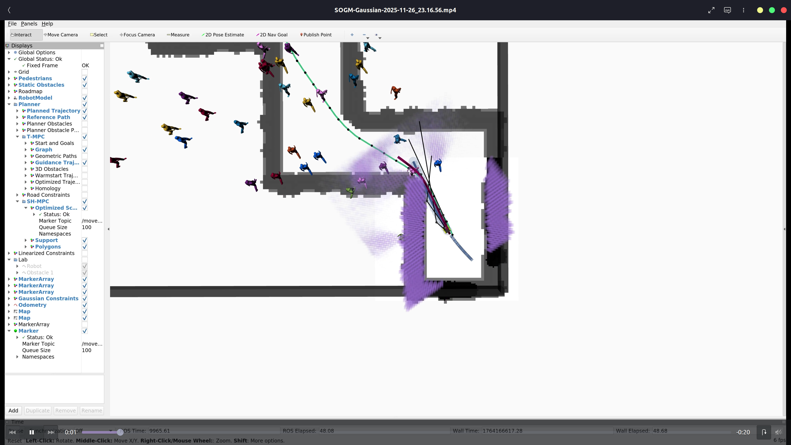

# Simple Start

## Environment

- Ubuntu 20.04
- ROS Noetic
- Docker environment recommended
- VS Code with Dev Containers extension

It is recommended to run this workspace inside a Docker Dev Container to avoid dependency issues.


## Steps

1. Open VS Code and load the folder `mpc_planner_step_map_ws`.
2. Open the command palette (Ctrl+Shift+P) and run:
    
    **Dev Containers: Rebuild and Reopen in Container**
    
    (Dev Containers extension must be installed.)
    
3. Inside the container, run:
    
    ```bash
    source setup_poetry.sh
    ```
    
4. Run the following VS Code task (Ctrl+Shift+B):
    
    **ROS Navigation: Generate Solver**
    
5. Run (Ctrl+Shift+B):
    
    **ROS Navigation: Build**
    
6. Run (Ctrl+Shift+B):
    
    **ROS Navigation: Run Simulator**
    
    Note: On first launch inside Docker, Gazebo may take extra time to load.
    


## Result Example

